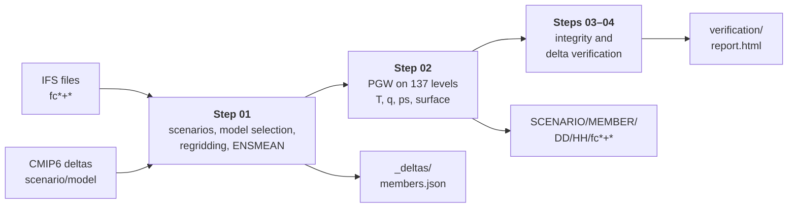
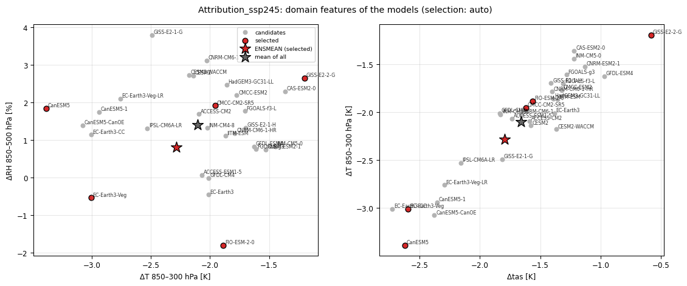
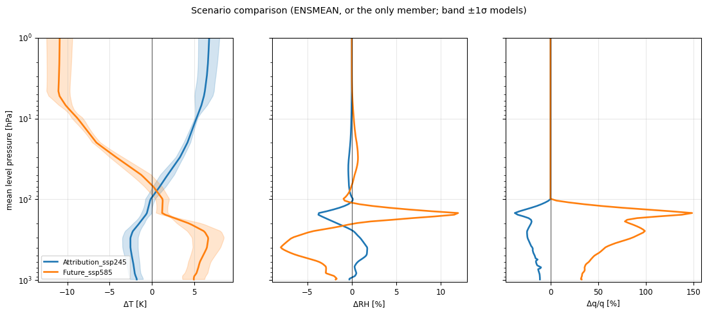
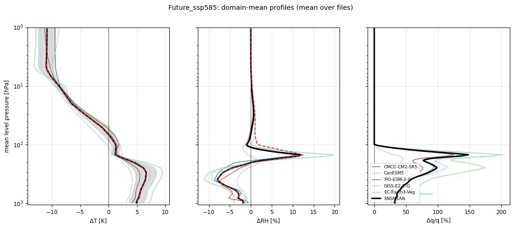
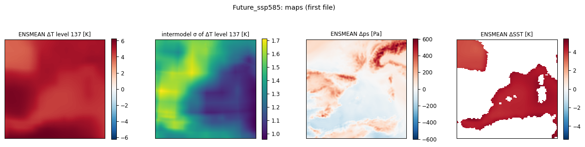
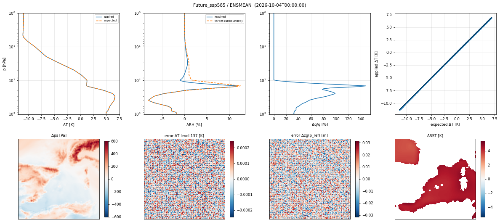
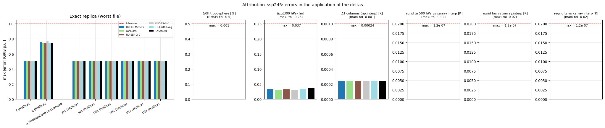

# Multi-model PGW for HARMONIE on IFS model levels

Pseudo-global warming (PGW) perturbation of the IFS **model-level** initial and
boundary conditions used by HARMONIE (137 hybrid levels), driven by monthly
CMIP6 climate deltas on pressure levels. The workflow selects $X$ CMIP6
models (from a user list or automatically), runs one or several scenarios
(attribution and end-of-century projections) and produces $X+1$ perturbed
sets of boundary files per scenario: one per model and one for the
multi-model ensemble mean (ENSMEAN). A verification step checks every
perturbed field against its expected change and writes a self-contained HTML
report.

The methodology follows PGW4ERA5 ([Brogli et al., 2023](https://doi.org/10.5194/gmd-16-907-2023);
[code](https://github.com/Potopoles/PGW4ERA5)), adapted to IFS GRIB files on a
rotated grid with mixed GRIB1/GRIB2 encoding.

📄 **Technical note (PDF):** [`docs/latex/pgw_modellevels_technical_note.pdf`](docs/latex/pgw_modellevels_technical_note.pdf)

---

## Contents

1. [Design](#1-design)
2. [Quick start](#2-quick-start)
3. [Input data](#3-input-data)
4. [Configuration](#4-configuration)
5. [Method](#5-method)
6. [Verification](#6-verification)
7. [Example](#7-example-western-mediterranean-4-october-2026)
8. [Output](#8-output)
9. [Repository layout](#9-repository-layout)
10. [Limitations](#10-limitations)
11. [References](#11-references)

---

## 1. Design

PGW experiments compare the simulation of an observed event with simulations
driven by the same boundary conditions perturbed with a climate-change signal
$\Delta$ diagnosed from global climate models (GCMs). The design is
conditional: given an event with a similar synoptic evolution, the
experiments evaluate how the imposed thermodynamic perturbation modifies the
simulated event. They do not estimate changes in the probability of the event
or of its circulation.

The workflow:

* applies the deltas on the native IFS hybrid levels, so HARMONIE reads the
  PGW files exactly as the original ones (same names, number and order of
  messages, and metadata);
* samples the climate signal with several CMIP6 models plus their ENSMEAN,
  for one or more scenarios, in a single SLURM job;
* verifies every perturbed set quantitatively.



---

## 2. Quick start

```bash
cd pgw_workflow_modelLevels_auto
# edit the header of run_PGW_HARMONIE_ML.sh (SCENARIOS, MODELS, N_MODELS, ...)
sbatch run_PGW_HARMONIE_ML.sh <path_input> <path_output> <cmip_root> <month>
```

| Argument | Description |
|----------|-------------|
| `path_input`  | Root with the IFS files, searched recursively for `fc*+*` (e.g., `.../ECMWF/BCN_Tropical/2026/10` with `DD/HH/fcYYYYMMDD_HH+000`). |
| `path_output` | Output root: `<path_output>/<SCENARIO>/<MEMBER>/DD/HH/fc...`, with the same structure and file names as `path_input`. |
| `cmip_root`   | Root of the CMIP6 deltas, e.g., `/ec/res4/hpcperm/ecme2143/CMIP6_deltas` (§3.2). |
| `month`       | `1..12`: fixed month (as `cdo seltimestep`). `auto`: linear interpolation between the two months that bracket the validity time of each file. |

Example (attribution 2026 + ssp585, 5 automatic models + ENSMEAN = 12 sets of
boundary files):

```bash
sbatch run_PGW_HARMONIE_ML.sh \
    /ec/res4/scratch/spcc/hm_home/ECMWF/BCN_Tropical/2026/10 \
    /ec/res4/scratch/ecme2143/PGW_BCN_Tropical/2026/10 \
    /ec/res4/hpcperm/ecme2143/CMIP6_deltas \
    10
```

To run HARMONIE with one member, point the boundary directory of the
experiment (`BDDIR` in `ecf/config_exp.h`) to
`<path_output>/<SCENARIO>/<MEMBER>`.

**Notes**

* The script can be submitted from any directory. The code is taken from the
  physical location of `run_PGW_HARMONIE_ML.sh` (under `sbatch`, through
  `scontrol`), and relative paths are resolved with respect to the submission
  directory.
* The SLURM log goes to `logs/pgw_harmonie_ml_<jobid>.out` **relative to the
  submission directory** (SLURM does not expand variables in `#SBATCH`). When
  submitting from elsewhere, create `logs/` there or use `sbatch -o <log>`.
* Cost: about 4–9 s per (member, file) and process in Step 02, and less in
  the verification.

### Software environment

```bash
source env.sh   # = source /home/spcc/bashrc_spcc + module load python3/3.11.10-01
```

> **Warning.** Specific humidity is packed with **CCSDS** in these files. Other
> module combinations (for example a plain `ecmwf-toolbox` from a login shell)
> make ecCodes segfault when decoding it, even with `grib_get`. The
> combination in `env.sh` (ecmwf-toolbox/2026.04 with the HARMONIE ecCodes
> definitions, ecCodes 2.47, and python3/3.11.10-01 with xarray, scipy,
> eccodes and matplotlib) is tested. For the same reason the run script uses
> `set -eo pipefail` without `-u`.

---

## 3. Input data

### 3.1 IFS boundary files (`fcYYYYMMDD_HH+SSS`)

567 GRIB messages on a `rotated_ll` grid of 157×155 points (0.09°, rotated
south pole at −49°N, 2.6°E) in the test domain:

| Level type | Fields | Encoding |
|------------|--------|----------|
| `hybrid` 1–137 | t, u, v, q | GRIB2 (q in CCSDS) |
| `hybrid` 1 | lnsp, z (surface geopotential) | GRIB2 |
| `surface` | skt, sst\*, ci\*, lsm, sd, asn, rsn, src, slt | GRIB1 |
| `depthBelowLandLayer` | stl1-4, swvl1-4 | GRIB1 |

(\*) bitmap with missing values over land. **u, v are grid-relative**
(`uvRelativeToGrid=1`). The hybrid coefficients (a, b) are read from the `pv`
array of each file.

### 3.2 CMIP6 deltas and scenarios

Monthly climatological differences (12 months) on the native grid of each
GCM, with 25 pressure levels (1000–1 hPa), organized by scenario. Periods are
taken from the `pgw_delta` attribute of the files.

| Scenario (`SCENARIOS`) | Path under `cmip_root` | Delta | Models | Complete |
|------------------------|------------------------|-------|-------:|---------:|
| `Attribution_ssp245` | `Attribution/ssp245/<YYYY>/<MODEL>/` | historical 1850–1879 minus the 30-year window [YYYY−15, YYYY+14] (2011–2040 for 2026); YYYY = 2020–2030 | 47 | 41 |
| `Future_ssp245` | `Future_ssp245/<MODEL>/` | ssp245 2070–2099 minus historical 1985–2014 | 47 | 41 |
| `Future_ssp370` | `Future_ssp370/<MODEL>/` | ssp370 2070–2099 minus historical 1985–2014 | 45 | 35 |
| `Future_ssp585` | `Future_ssp585/<MODEL>/` | ssp585 2070–2099 minus historical 1985–2014 | 38 | 31 |

"Complete" counts the models with all the variables required by the default
configuration. The attribution delta is negative in the troposphere
(counterfactual minus present-day climate). The code does not assume any sign.

| Variable | Units | Use |
|----------|-------|-----|
| `ta`, `hur` | K, % | 3D ΔT and ΔRH |
| `tas`, `hurs` | K, % | surface anchor of ΔT and ΔRH |
| `zg` | m | target of the hydrostatic surface-pressure adjustment |
| `ts` | K | skt, sst and soil temperatures |
| `ps` | Pa | only with `PS_MODE=gcm` |
| `ua`, `va` | m s⁻¹ | only with `PERTURB_WIND=true` |

The older layout `<root>/<MODEL>_global/` (e.g., `CMIP6_ATTRIB_ssp245`) is
also supported with `SCENARIOS=""` and `MODEL_SUFFIX="_global"`.

---

## 4. Configuration

All options are set at the top of `run_PGW_HARMONIE_ML.sh`.

### 4.1 Scenarios and models

| Variable | Default | Meaning |
|----------|---------|---------|
| `SCENARIOS` | `"Attribution_ssp245 Future_ssp585"` | Scenarios under `cmip_root` (`_` and `/` are equivalent), or `all`. Empty: `cmip_root` is a model directory. |
| `ATTRIB_YEAR` | `auto` | Event year of the attribution deltas. `auto` takes the year of the validity times of the files. |
| `MODELS` | `auto` | Explicit list (`"EC-Earth3 MIROC6 MRI-ESM2-0"`, case-insensitive), `all`, or `auto`. |
| `N_MODELS` | 5 | Number of models with `MODELS=auto`. |
| `AUTO_METHOD` | `spread` | `spread` spans the ensemble; `representative` takes the models closest to the multi-model mean. |
| `COMMON_MODELS` | true | Same models in all scenarios (intersection of the complete models). |
| `MAKE_ENSMEAN` | true | Additional ENSMEAN member of the X models. |
| `MODEL_SUFFIX` | `""` | Suffix of the model directories (`_global` in the older layout). |

### 4.2 Perturbation options

| Variable | Default | Meaning |
|----------|---------|---------|
| `PERTURB_T` | true | T + ΔT |
| `PERTURB_Q` | true | q from RH + ΔRH |
| `PERTURB_WIND` | **false** | u, v + Δu, Δv (rotated). PGW4ERA5 perturbs the wind. |
| `PS_MODE` | hydrostatic | `hydrostatic`, `gcm` or `none` |
| `P_REF` | 30000 Pa | Reference level of the hydrostatic adjustment (PGW4ERA5: 300 hPa) |
| `SFC_ANCHOR` | true | Surface correction with Δtas/Δhurs |
| `SFC_BLEND_DEPTH` | 10000 Pa | Depth of that correction |
| `Q_TAPER_BOTTOM/TOP` | 15000/10000 Pa | Taper of Δq toward the stratosphere |
| `RH_MIN_FACTOR` | 0.5 | RH′ ≥ factor · RH |
| `PERTURB_SKT/SST/SOIL` | true | Surface and soil |
| `COAST_BUFFER` | 2 | Erosion of the sea mask (grid points) |
| `SST_SMOOTH_SIGMA` | 1.0 | Gaussian smoothing of ΔSST (grid points) |

Each step can also be run on its own (`python3 stepXX_*.py --help`).

---

## 5. Method

### 5.1 Step 01: scenarios, models and deltas on the HARMONIE grid

**Model screening.** A model is a candidate when all required variables are
present. With `COMMON_MODELS=true`, only models that are complete in every
requested scenario are kept. Models that fail any check, or fail later while
being read or regridded, are **excluded with a warning and the workflow
continues**. Exclusions and reasons are listed in the log,
`_deltas/members.json` and the report. With `Attribution_ssp245` (2026) and
`Future_ssp585`, 30 common models remain. Most exclusions come from missing
`hurs` (AWI-CM-1-1-MR, BCC-CSM2-MR, CAMS-CSM1-0, CIESM, E3SM-1-0, ...).

**Automatic selection.** Each model $m$ is described by three domain features
computed on its **native** grid inside the latitude–longitude box of the
domain (1° margin, $\cos\varphi$ weights) and averaged with the monthly
weights of all the files:

$$
\mathbf{x}_m = \left(\overline{\Delta T}_{850-300},\ \Delta T_{as},\ \overline{\Delta \mathrm{RH}}_{850-500}\right).
$$

With several scenarios and common models, the feature vectors of all
scenarios are concatenated. Features are standardized,
$z_{m,j} = (x_{m,j}-\mu_j)/\sigma_j$, and $d_m = \lVert \mathbf{z}_m \rVert$
is the distance to the multi-model mean.

* `spread` (default): $s_1 = \arg\min_m d_m$, then
  $s_{n+1} = \arg\max_{m \notin S_n} \min_{s \in S_n} \lVert \mathbf{z}_m - \mathbf{z}_s \rVert$
  (farthest-point sampling). The $N$ models span the range of the full
  ensemble. Their mean does not need to coincide with the mean of all
  candidates.
* `representative`: the $N$ models with the smallest $d_m$.

Only the selected models are regridded.

**Horizontal interpolation.** Bilinear interpolation from the GCM grid to the
geographical coordinates of each HARMONIE point (box with a 3° margin,
periodic longitude). NaNs below the GCM orography, or in empty upper levels,
are filled by constant vertical extrapolation. Δu/Δv are rotated to the
rotated-grid basis when the GRIB winds are grid-relative (±6.8° in the test
domain, checked against the COSMO `uv2uvrot` formula).

**ENSMEAN.** Equal-weight mean of the regridded deltas of the $X$ models,
$\Delta_{ENS} = X^{-1}\sum_m \Delta_m$, for every month, level and variable.
The intermodel standard deviation is stored as `<var>_spread`. The ENSMEAN is
applied as one more member, so its perturbation is internally consistent
(T, RH and adjusted $p_s$ together) and is not the average of the $X$
perturbed states.

### 5.2 Step 02: PGW on hybrid model levels

Adaptation of `step_03_apply_to_era.py` of PGW4ERA5 with `i_reinterp = 0`:
the deltas are applied at the original pressures of the model levels.

1. **Hybrid pressures:** $p_{k+1/2} = a_{k+1/2} + b_{k+1/2}\,p_s$ and
   $p_k = (p_{k-1/2}+p_{k+1/2})/2$.
2. **Temporal selection:** fixed month, or
   $\Delta(t) = (1-w)\Delta_m + w\Delta_{m+1}$ with
   $w = (t-t_m)/(t_{m+1}-t_m)$ between mid-month dates (`month=auto`).
3. **Vertical interpolation:** linear in $\ln p$ with constant extrapolation
   above the highest and below the lowest GCM level, giving
   $\Delta_{std}(p)$. For ΔT and ΔRH, a continuous **surface anchor**:

   $$
   \Delta(p) = \Delta_{std}(p) + \left[\Delta_{sfc} - \Delta_{std}(p_s)\right]\max\left(0,\ 1-\frac{p_s-p}{D}\right),\qquad D = 100\ \mathrm{hPa}.
   $$

   PGW4ERA5 inserts the surface value at the historical GCM surface pressure,
   which these deltas do not provide. Here the anchor uses the IFS $p_s$. An
   earlier "hard" anchor that discarded the levels with $p > p_s$ produced
   jumps when $p_s$ crossed a pressure level. The linear blend removes them.
4. **Temperature:** $T' = T + \Delta T$.
5. **Humidity:** RH is computed with the IFS mixed water/ice saturation
   vapor pressure (Tetens; quadratic blend between 250.16 and 273.16 K), so
   that q → RH → q is exactly invertible.

   $$
   \mathrm{RH}' = \min\left[\max\left(\mathrm{RH}+\Delta\mathrm{RH},\ f\,\mathrm{RH}\right),\ \max(\mathrm{RH},1)\right],\qquad f = 0.5,
   $$

   $$
   q' = q + w_q(p)\left[q(\mathrm{RH}',T',p') - q\right],\qquad
   w_q = \mathrm{clip}\left(\frac{\ln p - \ln p_{top}}{\ln p_{bot} - \ln p_{top}},\,0,\,1\right).
   $$

   The upper bound keeps the supersaturation over ice that the IFS allows.
   The lower bound avoids $q \le 0$ in very dry air (intrusions with RH ≈ 0.4 %
   and ΔRH ≈ −3 %). Above $p_{top}$ = 100 hPa, q is unchanged. Without this
   taper, keeping RH under the stratospheric ΔT of the GCM gave Δq/q between
   +50 % and +300 %, which has no physical basis.
6. **Surface pressure (`PS_MODE=hydrostatic`):** the geopotential is
   integrated upward from the unchanged surface geopotential,
   $\Phi_{k-1/2} = \Phi_{k+1/2} + R_d T_{v,k}\ln(p_{k+1/2}/p_{k-1/2})$, and
   $p_s$ is iterated until the change in geopotential at $p_{ref}$ = 300 hPa
   matches the GCM:

   $$
   E = \left[\Phi'(p_{ref})-\Phi(p_{ref})\right] - g\,\Delta z_g(p_{ref}),\qquad
   p_s \leftarrow p_s - 0.95\,\frac{p_s}{R_d\,T'_L}\,E,
   $$

   recomputing $q'$ with the new pressures at each iteration, until
   $\max|E| < 0.15\ \mathrm{m^2\,s^{-2}}$ (≈1.5 cm; at most 20 iterations,
   usually 5–6). The output is $\ln p_s'$. Alternatives: `gcm`
   ($p_s + \Delta p_s$) and `none`.
7. **Wind (optional):** $u,v + \Delta u,\Delta v$ (rotated), without surface
   anchor.
8. **Surface and soil:**
   * Over the sea, an **open-sea Δts**: the mask `lsm < 0.5` is eroded by
     `COAST_BUFFER` points, the rest is filled by inverse-distance weighting
     (8 neighbors, power 2) and smoothed with a Gaussian filter of
     `SST_SMOOTH_SIGMA` points. This keeps the land signal out of the
     coastal SST.
   * `skt += Δts` (open-sea Δts over the sea, GCM Δts over land);
     `sst += Δts_sea` at the valid points, keeping the bitmap.
   * `stl1-4 += Δts_annual + exp(−z/2.8 m)·(Δts − Δts_annual)`, with $z$ the
     mid-layer depth (0.035, 0.175, 0.64, 1.945 m), as in PGW4ERA5.
   * swvl, snow, ci, lsm, z, src and slt are not modified.
9. **Writing:** all messages are kept in their order and with their metadata,
   and only the values of the perturbed fields are replaced. Each file is
   written as `.tmp` and renamed once complete.

---

## 6. Verification

**Step 03 (integrity, per member):** same number of messages and identical
metadata, bit-identical non-perturbed fields, finite values, q ≥ 0 and an
unchanged SST mask.

**Step 04 (delta verification, all scenarios and members):** the expected
change of each field is recomputed and compared with the change written to
the file. Exact replicas are measured in GRIB packing units
(p.u. $= 2^{E}\,10^{-D}$, the quantization step of the message; rounding
gives at most 0.5 p.u.).

| Check | Comparison | Tolerance |
|-------|------------|-----------|
| Replica T, q, skt, sst, stl1-4 (u, v) | written change − change recomputed with the package formulas and the final $p_s$ of the file | ≤ 1 p.u. |
| ΔT on columns (`np.interp`) | 300 columns with an **independent** vertical interpolation | ≤ 1e-3 K + packing |
| Δzg($p_{ref}$) | $[\Phi'-\Phi]/g$ at $p_{ref}$ − GCM Δzg | max ≤ 0.25 m |
| ΔRH troposphere | RH from the final T, q, p − (RH + ΔRH), outside bounded points, $p \ge p_{bot}$ | RMSE ≤ 0.5 % |
| Stratospheric q | change of q above $p_{top}$ | ≤ 1 p.u. |
| SST mask, q ≥ 0 | | exact |
| Regridding | deltas on the grid − `xarray.interp` of the native deltas (300 points; tas, ta 500 hPa, ts) | ≤ 0.02 K |
| ENSMEAN deltas | ENSMEAN − mean of the model deltas | ≤ 1e-4 |
| ENSMEAN applied ΔT | ΔT(ENSMEAN) − mean ΔT of the models (linear in Δ) | ≤ 0.01 K |

ΔRH and Δps of the ENSMEAN are also compared with the mean of the models, for
information only (the RH bounds and the $p_s$ adjustment are nonlinear).

Outputs in `verification/`: `report.html` (self-contained, tables and
figures), `metrics.csv` (one row per scenario, member, file and check) and
`summary.txt`. The job exits with an error if any check fails, after running
all steps.

**Round-trip test.** With all deltas set to zero, the output must reproduce
the input within one packing unit:

```bash
source env.sh
python3 tests/test_zero_deltas.py <fc_file> <_deltas/.../deltas_on_grid.nc> <tmp_dir>
```

---

## 7. Example: western Mediterranean, 4 October 2026

IFS analysis valid at 00 UTC on 4 October 2026 for the HARMONIE domain
`BCN_Tropical` (33.8–48.0°N, 7.7°W–13.0°E), default options, `month=10`,
attribution (2026) and ssp585, `MODELS=auto`, `N_MODELS=5`, `spread`.

**Selection.** Of 30 common candidates, the selection returns CMCC-CM2-SR5
(closest to the multi-model mean), CanESM5, FIO-ESM-2-0, GISS-E2-2-G and
EC-Earth3-Veg. The mean of the five models differs from the mean of the 30
candidates by −0.18 K in tropospheric ΔT and −0.59 percentage points in ΔRH
in the attribution scenario.



**Applied perturbation (domain means).**

| Scenario | Member | ΔT850 (K) | ΔT500 (K) | ΔRH850 (%) | Δps (Pa) | ΔSST (K) |
|----------|--------|----------:|----------:|-----------:|---------:|---------:|
| Attribution (2026) | CMCC-CM2-SR5 | −1.63 | −2.04 | +0.58 | −105.7 | −1.30 |
| | CanESM5 | −3.02 | −3.51 | +1.01 | −94.9 | −2.33 |
| | FIO-ESM-2-0 | −1.61 | −1.98 | −1.68 | +134.4 | −1.28 |
| | GISS-E2-2-G | −1.08 | −1.20 | +3.59 | −44.2 | −0.14 |
| | EC-Earth3-Veg | −2.69 | −3.16 | −1.21 | +152.5 | −2.20 |
| | **ENSMEAN** | **−2.00** | **−2.38** | **+0.48** | **+8.6** | **−1.45** |
| ssp585 | CMCC-CM2-SR5 | +5.45 | +6.09 | −3.40 | −37.6 | +4.04 |
| | CanESM5 | +7.58 | +8.42 | −3.87 | +71.8 | +6.30 |
| | FIO-ESM-2-0 | +4.69 | +5.14 | −5.14 | +77.0 | +3.48 |
| | GISS-E2-2-G | +3.34 | +4.12 | −1.28 | −109.6 | +2.92 |
| | EC-Earth3-Veg | +5.16 | +6.44 | −0.83 | +225.3 | +4.37 |
| | **ENSMEAN** | **+5.25** | **+6.04** | **−2.90** | **+46.7** | **+4.22** |

Specific humidity at 850 hPa decreases by 11.5 % in the attribution ENSMEAN
and increases by 32.9 % in the ssp585 ENSMEAN (5.8 and 6.3 % per kelvin of the
local ΔT), combining the temperature dependence of the saturation vapor
pressure with the imposed ΔRH. Above 100 hPa q is unchanged by construction.







**Verification.** All checks pass for the 12 members. Replica errors are
0.50 p.u. for T, skt, sst and stl1-4 (2.4·10⁻⁴ K for T) and 0.77 p.u. for q.
Δzg at 300 hPa departs from the GCM target by at most 3.7 cm, the
tropospheric ΔRH by an RMSE of 0.001 %, and the regridded deltas from
`xarray.interp` by less than 5·10⁻⁷ K. The applied ΔT of the ENSMEAN equals
the mean applied ΔT of the models within 4.6·10⁻⁴ K.





---

## 8. Output

```
<path_output>/
├── _deltas/
│   ├── members.json, members.txt          selection, exclusions, features
│   └── <SCENARIO>/<MODEL|ENSMEAN>/deltas_on_grid.nc
├── <SCENARIO>/<MEMBER>/
│   ├── DD/HH/fcYYYYMMDD_HH+000            PGW files
│   └── pgw_options.json, pgw_diagnostics.jsonl
└── verification/
    ├── report.html                         self-contained report
    ├── metrics.csv, summary.txt
    └── figs/*.png
```

Prepared deltas are reused in later runs if they are newer than the original
delta files.

---

## 9. Repository layout

```
├── run_PGW_HARMONIE_ML.sh      # SLURM driver (configuration at the top)
├── env.sh                      # Software environment
├── step01_prepare_ensemble.py  # Scenarios + model selection + regridding + ENSMEAN
├── step01_prepare_deltas.py    # Single model (one-off use)
├── step02_apply_pgw.py         # PGW (all files x members, in parallel)
├── step03_check_pgw.py         # Integrity of each member
├── step04_verify_deltas.py     # Delta verification + HTML report
├── pgw_ml/
│   ├── constants.py            #   IFS constants
│   ├── thermo.py               #   IFS mixed e_sat, RH <-> q, Tv
│   ├── vertical.py             #   hybrid pressures, hydrostatic Φ, ln p interpolation
│   ├── grids.py                #   rotated pole, regridding, wind rotation
│   ├── gribio.py               #   IFS GRIB reading/writing
│   ├── prepare.py              #   deltas of one model -> HARMONIE grid
│   ├── ensemble.py             #   scenarios, model selection, ENSMEAN
│   ├── deltas.py               #   prepared deltas + temporal selection
│   ├── sst.py                  #   open-sea ΔSST (IDW)
│   ├── apply.py                #   PGW algorithm for one file
│   └── verify.py               #   verification metrics for one file
├── tests/test_zero_deltas.py   # Round-trip test with zero deltas
├── docs/
│   ├── latex/                  # Technical note (LaTeX source + PDF)
│   └── figures/                # Example figures
└── logs/
```

---

## 10. Limitations

* The experiments keep the synoptic evolution of the driving analysis. They
  evaluate conditional changes in the simulated event, not changes in its
  probability, frequency or circulation.
* The wind is not perturbed by default. Similar winds in the perturbed
  simulations reflect this design and do not imply an absence of dynamical
  change.
* The deltas are monthly climatologies. Sub-monthly variability of the
  climate signal is not represented.
* The $X$ selected models sample part of the intermodel uncertainty. With
  `spread`, the ENSMEAN of the $X$ models can differ from the mean of all
  candidates. Internal variability and the construction of the perturbation
  are not sampled.
* Constant extrapolation is used above 1 hPa and below the lowest GCM level.
  q is not perturbed above 100 hPa.
* A HARMONIE integration with the perturbed files (boundary processing and
  forecast) has not been tested yet.

---

## 11. References

* Brogli, R., Heim, C., Mensch, J., Sørland, S. L., and Schär, C. (2023): The
  pseudo-global-warming (PGW) approach: methodology, software package
  PGW4ERA5 v1.1, validation, and sensitivity analyses. *Geosci. Model Dev.*,
  16, 907–926. <https://doi.org/10.5194/gmd-16-907-2023>
* Eyring, V., et al. (2016): Overview of the Coupled Model Intercomparison
  Project Phase 6 (CMIP6) experimental design and organization. *Geosci.
  Model Dev.*, 9, 1937–1958. <https://doi.org/10.5194/gmd-9-1937-2016>
* Schär, C., Frei, C., Lüthi, D., and Davies, H. C. (1996): Surrogate
  climate-change scenarios for regional climate models. *Geophys. Res.
  Lett.*, 23, 669–672. <https://doi.org/10.1029/96GL00265>
* ECMWF: IFS Documentation, Part III (Dynamics and Numerical Procedures) and
  Part IV (Physical Processes).

**License:** [MIT](LICENSE)

**Author:** Carlos Calvo-Sancho, Centro de Investigaciones sobre Desertificación,
Consejo Superior de Investigaciones Científicas (CIDE, CSIC-UV-GVA), Climate,
Atmosphere and Ocean Laboratory (Climatoc-Lab), Moncada, Valencia, Spain.
